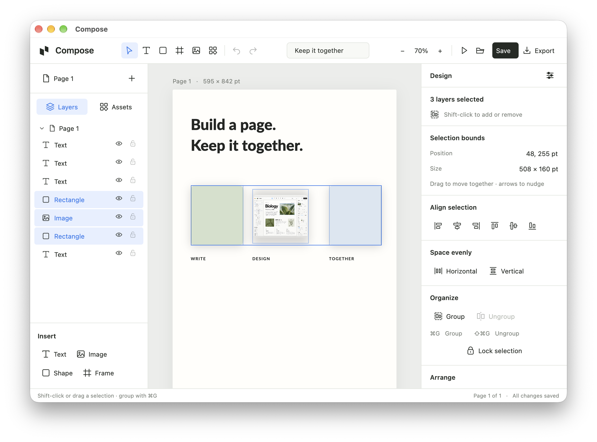

# Compose

A lightweight alternative to Microsoft Word, with canvas design tools for
reports, homework, posters and everyday documents.

**Write like a document. Design like a canvas.**

Compose combines rich text editing with movable images, shapes, layers and
groups in a calm native interface. Built in Rust with GPUI and Parley, without
Electron or webviews.



Compose is in active development. macOS is currently tested; Windows/Linux
interaction checks are still pending; native Windows packaging is included.
It uses its own editable
`.compose` files in both modes. Word-compatible mode can export editable DOCX;
DOCX import is not implemented yet.

## Run

A native Android version with desktop icons, fonts and editable components is available too. Build an APK with
`./scripts/package-android.sh`; see [Android instructions](android/README.md)
for supported devices, mobile features and emulator checks. It shares the Rust
document engine and `.compose` files with desktop.

Install Rust (currently validated with 1.98.1). On macOS, install the Xcode
Command Line Tools with `xcode-select --install`; the build uses Swift only for
the small native printing adapter.

```sh
cargo run -p compose
# Open a saved document:
cargo run -p compose -- /path/to/document.compose
```

On macOS, create a local development app bundle:

```sh
./scripts/package-macos.sh
open dist/Compose.app
```

The bundle includes fonts and a vector app icon. It is locally ad-hoc signed,
not a notarized distribution. macOS is the platform tested in this workspace.
Linux/Windows support still needs platform-specific builds and interaction QA.

## Working features

- Shape picker with Rectangle, Circle, Oval, Triangle, Diamond, Pentagon,
  Hexagon, Star, Arrow and Line. Draw or drag figures onto the page, or change a
  selected shape's type in the inspector. Circles stay proportionate; polygons
  support rounded corners, colors, borders and shadows.
- Two document modes: Word-compatible text/image layouts with editable DOCX
  export, and the full Compose canvas with shapes, frames, groups and effects.

- Six bundled typefaces with actual family previews, live search, real weights,
  italic variants where available, and seven typography presets.
- Rich text formatting applies only to the highlighted passage. Mixed sizes,
  family, weight, color, spacing, line height and alignment remain editable.
- Continuous HSV color picker with hex/RGBA and alpha input, 32 palette colors,
  and colors already used in the document. One color drag is one undo step.
- Assets library: Title, Callout, Pull quote, Key number, Feature card and Divider.
  Components insert as editable nested frames/text/shapes; they are independent
  layouts, not linked instances.
- Visual object fills, rounded corners, strokes and soft drop shadows, persisted
  in `.compose` files. Images retain original bytes and proportionate Scale mode.
- Layers tree with visibility, locks, nesting, renaming, ordering and duplication.
- Shift-click and marquee selection, shared movement/nudging, batch clipboard,
  grouping/ungrouping, alignment and even spacing for several objects.
- Multiple pages, page-size presets/orientation, editable document title, preview,
  pan/zoom, snapping, inspector fields and native menus.
- Undo/redo, native file dialogs, atomic saves and unsaved-change prompts.
- Export editable `.compose` copies and current-page PNGs at 1×, 2× or 300 DPI.
  Print all pages through the macOS print dialog, including its Save as PDF option.
- Copy/cut/paste layers and nested frames across documents in the same running
  app. Pasted images keep their original bytes and attribution.
- Copy highlighted passages with inline formatting; paste external text onto the
  canvas to create an editable text box.
- Replace images from your computer, web search or Commons while keeping their layer name,
  position, width and appearance. Scale adjusts height to the new proportions;
  Stretch keeps both dimensions.

Click the document title to rename it. The **Assets** tab holds editable layout
blocks. The typeface field opens the font picker; the color row opens the palette
and continuous picker. Use the eye/lock icons beside each layer. The preview
triangle hides editing controls; Escape returns to the editor.

Double-click a blank area to write. **T** also lets you click and drag within an
existing text box to highlight a passage. Double-click a word to select it. Bold,
italic, underline, font size, family, and color apply only to that selection;
the floating toolbar stays with the selected text. The inspector shows `Mixed`
when selected characters have different property values.

Highlight a passage to open its centered text menu. Choose fonts, weights, exact
sizes or presets, text styles, bold/italic/underline, color or clear formatting
right beside the selection. Font search is focused automatically; Enter applies
the first match. Styles include Title, Heading, Subheading, Body, Caption, Quote
and Code. All changes apply to the highlighted passage. Run native interaction
checks with `cargo run -p compose -- --ui-smoke --text-menu`.

Check every bundled native font face and the Light/Black controls with
`cargo run -p compose -- --ui-smoke --font-weights`. The renderer maps typographic
family names consistently between Parley and GPUI, including extended weights
and italic variants.

Images default to **Scale**, which preserves their original proportions with
any handle or width/height field. **Smaller** and **Bigger** uniformly scale by
10% around the center. Choose **Stretch** for independent dimensions; choosing
Scale again restores the original aspect ratio. These edits retain original
image bytes and are undoable.

**Corners** provides Square, Soft, Round and an exact radius field. Drag the
small round handle inside a selected image or shape to adjust its corners.
The eight square handles resize the element; the cursor indicates their direction.

Use V/T/R/F for select/text/rectangle/frame. Hold Shift to constrain proportions.
O selects the Oval tool. Click **Shapes** in Insert or the toolbar for all figures.
Pick one and click/drag on the page, or drag it directly from the picker.
Select a figure and use **Shape** in the inspector to change its type while
keeping its styling. Circle dimensions stay equal; Line has a thickness field.
Alt resizes about the center or bypasses move snapping. Space+drag or the wheel
pans. Cmd/Ctrl+wheel zooms; clicking the zoom percentage fits the page.
On macOS, pinch the touchpad to zoom; two-finger scrolling pans. Pinch and
modifier-scroll zoom stay anchored near the pointer.
Cmd/Ctrl+S saves, Shift+Cmd/Ctrl+S saves as, O opens, N creates a blank document,
Z undoes, Shift+Z redoes, D duplicates. B/I/U format selected text. Escape leaves
text editing. Numeric inspector fields accept typed values; Enter commits and
Escape cancels. Colors accept six-digit hex. Double-click a layer to rename it.

Clipboard currently handles text. Object duplication uses Cmd/Ctrl+D. Text is
edited in independent boxes; automatic flow between pages, lists, tables,
rotation, vector PDF/HTML export, DOCX import, collaboration and cloud features are later work.
System fallback typography, screen-reader support and large-image performance
need more validation. IME range handling is tested; all OS/language candidate
window behavior is not yet certified.

## Verify

```sh
cargo test --workspace
cargo run -p compose -- --smoke-test
cargo run -p compose -- --ui-smoke
cargo run -p compose -- --ui-smoke --refinements
cargo run -p compose -- --ui-smoke --polish
cargo run -p compose -- --ui-smoke --shapes --compact
```

The native smoke test sends events inside Compose; it doesn't move the real
pointer or change the clipboard. It writes `artifacts/native-smoke.compose`.
Use `--ui-smoke-hold` to leave its editable fixture open for visual inspection.

Run `cargo run -p compose -- --ui-smoke --workflows` for clipboard and replacement
regressions. The checks leave your OS clipboard untouched. Object transfer between
separate app instances remains unsupported; readable text is the fallback. See
`docs/FEATURE_GAPS.md` for the prioritized remaining features.
The refinement checks use `artifacts/refinement-checks/`, so the original sample
is not overwritten. Add `--show-text-selection` with `--ui-smoke-hold --refinements`
to inspect the selected-word toolbar. Native screenshots are saved as
`artifacts/editor-images-v2.png` and `artifacts/editor-text-v2.png`.

Architecture is in `ARCHITECTURE.md`; design decisions and the original image
references are in `DESIGN.md` and `brand/`. Font licenses and the small GPUI API
bridge are documented under `assets/fonts/` and `vendor/README.md`.

The 0.3 showcase and native screenshots are under `artifacts/polish/`. Use
`--ui-smoke-hold --polish --show-fonts` or `--show-colors` for visual inspection,
and `--compact` for the minimum window size. These tests stay inside Compose
and do not move the system pointer or change the clipboard. Final visual QA
uses the packaged application because macOS can defer presentation of fully
occluded background windows.

Release limits: synchronized component instances, selection/group scaling, rotation, vector
path editing, linked text pagination, further export/import formats and multi-platform release
certification remain future milestones. This is a local macOS development build,
not full Figma parity. Review availability is recorded in the validation artifacts.

## Add images from your computer or the web (0.6)

Click **Image** in the toolbar or Insert area to open the native image picker.
**My computer** opens the system file chooser. **Search online** searches
the full web through Bing Images inside Compose: enter a phrase and press Enter,
or use a suggestion. **Commons** remains a separate optional source. Select a
thumbnail, inspect its title and originating website, and click
**Insert image**. More images loads the next results page.

The selected original raster image is embedded in the `.compose` file; source,
creator and license metadata, when provided, are saved with it and shown in the inspector.
Search needs an internet connection; an inserted image stays available offline.
Source and license links open only when clicked. Web search requires no API key;
unknown usage rights remain unknown. If a website blocks its original download,
**Insert preview** explicitly uses the cached lower-resolution thumbnail. Search
errors also offer **Open search in browser**. Bing's public result markup can change;
Compose reports provider failures instead of silently switching to a catalog.

Search and image decoding run on background workers. Closing the picker cancels
pending UI effects; a newer search rejects older replies. The picker shows loading,
empty, error/retry and preview-failure states. Supported originals are JPEG, PNG,
WebP, GIF and BMP, limited to 64 MB / 32 megapixels. GIFs currently insert their
first frame. Images retain the existing Scale/Stretch and corner controls.

Explicit integration checks (these access Bing and Commons):

```sh
cargo run -p image_search --example live
cargo run -p compose -- --image-picker-test
# Leave the results visible for inspection:
cargo run -p compose -- --image-picker-hold --compact
```

Offline tests use recorded search metadata. Live tests exercise native tab and
query controls, thumbnails, original download, insertion, attribution, undo,
reopening, local loading, invalid images and stale-request cancellation.

## Export and print (0.7)

Click **Export** in the top bar, or press **⇧⌘E**. **Compose file** exports a fully
editable copy with every page and embedded image. The current document's save
location and saved/unsaved state are retained. **Save** still updates the working
file, and **Save As** changes its location.

**Export PNG** writes the current page without editor controls. Choose 1× (72 DPI),
2× (144 DPI), or 300 DPI; the menu shows the pixel dimensions. PNGs keep text
layout, mixed fonts, image proportions, rounded corners, layer order, opacity,
strokes and shadows. PNG export uses document coordinates and is independent of
zoom or window size. Very large pages can require a lower resolution.

**Print…** or **⌘P** prepares all document pages at 300 DPI and opens the macOS
print dialog. Choose a printer, copies and page range, or use the dialog's
**Save as PDF**. Cancelling leaves the document untouched. Print output currently
uses raster pages; system paper/printer margins may scale the document. Native
printing on Windows/Linux and vector PDF export remain future work.

Both operations run in background workers. They use local snapshots and never
require a network connection. The File menu also exposes the export/print actions.
The bundle includes the small native print adapter; users do not need Swift tools.

```sh
# Native export controls and a two-page print-to-PDF check (no physical printing):
cargo run -p compose -- --ui-smoke --output
# Also open and automatically dismiss the system print panel safely:
cargo run -p compose -- --ui-smoke --output --check-print-dialog
```

## Select and organize layouts (0.8)

Use **Shift-click** on the canvas or in Layers to add/remove objects. Drag a
rectangle from empty space to select several objects; hold Shift to add to the
current selection. **⌘A** selects page objects when you are not editing text.
Drag the selection to move it together. Arrow keys nudge it by 1 pt; Shift+arrows
use 10 pt. Copy/cut/paste, duplicate, delete and layer ordering operate on the
whole selection and keep a single undo step.

The inspector shows selection bounds, six alignment controls and horizontal or
vertical spacing for three or more objects. **Group** / **⌘G** groups unlocked
layers with the same parent. A normal click moves the group; double-click to
edit a child. Escape returns to its group. **Ungroup** / **⇧⌘G** restores the
children and their positions. Groups follow their contents when children move
or text reflows, preserve embedded images and reopen in `.compose` documents.

Grouping keeps selected layers' order and places the group at their frontmost
selected layer. For nonadjacent layers, this can change their stacking relative
to unselected objects between them. Grouping across different parents is currently
disabled. Multiple-selection and group scaling are not yet implemented, so these
selections show movement bounds without resize handles. Individual objects retain
their normal resizing, corners and text formatting controls.

```sh
cargo run -p compose -- --ui-smoke --selection --compact
# Leave the real selection inspector visible:
cargo run -p compose -- --ui-smoke-hold --selection --compact
# Inspect the grouped version:
cargo run -p compose -- --ui-smoke-hold --selection --show-selection-group --compact
```

## Touchpad zoom (0.8.1)

Pinch in or out over the workspace to zoom smoothly between 15% and 400%.
Two-finger scrolling continues to pan, and Ctrl/⌘-scroll also zooms. The document
point near the pointer stays fixed while zoom changes, including multiple input
events before the next redraw. Sidebar/popover gestures do not zoom the page.
Camera changes retain text/object selection, saved state and history.

```sh
# Tests the actual macOS view callback with synthetic AppKit gesture events:
cargo run -p compose -- --ui-smoke --touchpad --compact
```

## License

Compose's original source code is MIT licensed. Vendored GPUI retains its
Apache-2.0 license, and bundled fonts retain their included font licenses.

## Word-compatible and Compose modes (0.9)

The **Canvas / Word** button in the toolbar opens the document mode chooser.
**Compose** keeps the freeform editor: shapes, frames, groups, effects, image
corners and arbitrary placement. Compose-mode documents cannot export DOCX;
the option is disabled and the exporter enforces that restriction.

**Word-compatible** uses editable text and proportionate images in reading order
with one-inch page margins. The inspector provides typography, text color, image
width and block order controls. Shapes, groups, free placement, transparency and
canvas effects are disabled. **Export → Word document (.docx)** produces real
paragraphs, styled runs and embedded images, with page settings and section breaks.
Font sizes, bold/italic/underline, colors, letter spacing, alignment and line
spacing are retained. Word may substitute missing fonts and reflow content; exact
pagination is not guaranteed. Install the bundled font families for closer output.

Both modes save editable `.compose` files, preserving the mode. Old files default
to Compose. A compatible canvas can switch to Word mode and reflow; Undo restores
its previous layout. A canvas using unsupported features cannot switch without
losing them, so the chooser offers **New Word document** instead. New documents
respect the normal unsaved-change prompt. **File → New Word-compatible document…**
opens the creation screen with Word mode selected.

Word-mode blocks currently flow within explicit Compose pages; text is not linked
between pages automatically. Oversized blocks show a warning. DOCX keeps their
complete text for Word to paginate; PNG/Print rejects overflow instead of silently
clipping it. Split oversized blocks across pages before using those outputs.

```sh
cargo run -p compose -- --ui-smoke --document-modes --compact
# Inspect the mode chooser and the real compatible editor:
cargo run -p compose -- --ui-smoke-hold --document-modes --compact
```

## Create a document (0.11)

Opening Compose without a file shows the native creation screen. Choose **Blank
page**, **Résumé**, **Photo résumé**, **Photo cover**, **Report**, **Letter**,
**Portfolio** or **Poster**, select **Compose** or
**Word-compatible**, name the document and click **Create document**. The preview
renders the actual document. Every preset creates editable text and layers;
The gallery scrolls to the second row at compact window sizes. Résumé works in
both modes; Photo résumé, Photo cover, Portfolio and Poster require Compose to
preserve their columns, placement, rounded images and shapes.

**Open document…** reopens a `.compose` file. Opening one from the command line
goes directly to its editor. **File → New document…** / **⌘N** returns to the
creation screen. Choosing presets leaves your current document intact. Creating
its replacement prompts to save unsaved changes; **Back to document** returns
without replacing it. Both modes save locally as `.compose`.

In Compose, choose **Text (T)** and drag on the page to draw the box's width and
height. A simple click inserts one default box. Shape and Frame use the same
drag-to-size behavior, including reverse drags; **Escape** cancels before insertion.
Typing retains your chosen height and expands it as needed. Single-click and drag
to move an object; double-click to edit text. Drag the selected text border to
move its box while editing, or right-click and choose **Select / move text box**.
Word text retains its reading-order layout and fixed column width.

Right-click objects or Layers for working clipboard, duplicate, rename, order,
lock/unlock and delete actions. Highlighted text keeps its range for copying.
Locked objects can be inspected and unlocked through this menu, while dragging
and editing stay blocked. The export menu explains which canvas features would
be lost in Word; Compose-mode DOCX export stays disabled, so nothing is silently
removed from your file.

```sh
cargo run -p compose -- --ui-smoke --creation --document-modes --compact
```

The **Résumé** contains editable name, contact details, profile, experience,
education and skills. **Photo résumé** adds a portrait and two-column layout.
**Photo cover** pairs a large image with an editorial title; **Portfolio** adds
project details and a large work sample. Their photographs are normal image
layers: select one and choose **Replace image…** to use a local file or web search.
The original bytes, proportions and editable corners survive `.compose` reopening.
No network access is needed to use a preset. Generated sample images and their
prompts are documented in [assets/presets/SOURCES.md](assets/presets/SOURCES.md).

```sh
cargo run -p compose -- --ui-smoke --presets --compact
# Inspect the native gallery or editable portrait résumé:
cargo run -p compose -- --ui-smoke-hold --presets --compact
cargo run -p compose -- --ui-smoke-hold --presets --show-photo-editor
```

## Drag, hyperlinks and background removal (0.12)

Drag rows in **Layers** to reorder them. The blue edge shows the drop location.
Canvas stacking changes without moving objects; Word mode reflows its reading
order. Layers may move between existing groups by dropping beside a layer in the
destination group; invalid nesting and locked content are rejected.

Drag Text, Shape or Frame from **Insert**, or a component from **Assets**, onto
the page. Dragging Image opens its picker at that position. Drop image files from
Finder/Explorer directly onto the page; up to 16 are decoded in the background
and inserted as one undo operation. Dropping a `.compose` file opens it with the
normal unsaved-change protection.

Highlight text and press **Ctrl/⌘K**, or use the link icon, right-click menu or
inspector. Apply a web or email address, edit/remove it, or open it. **Ctrl/⌘-click**
follows links in the editor; Preview uses a normal click. Links retain their range
through formatting, clipboard and `.compose` saves, and export as clickable Word
hyperlinks. PNG and the current raster print/PDF output preserve their appearance
but cannot carry interactive links.

**Remove background** in the image inspector and **Without background** in image
search now use one shared Compose service. Users need **no account or API key**.
The desktop app contains only the public service address; the provider key stays
on the server. The selected image is uploaded when requested, and a transparent
preview PNG is returned. Shared usage limits apply. Position/style, original
pixels and Undo are preserved; failed or stale replies keep the working image.
There is no desktop ML runtime, model download or GPU inference requirement.

The server uses [bgclear's preview API](https://www.bgclear.ai/api-docs/) with
`size=preview` (up to 800 px); paid full-resolution size is never requested.
Deployment files and operator instructions are in
[services/background/README.md](services/background/README.md). The service is a
separate Rust executable with bounded requests, concurrency and shared limits;
it stores no images and has no user accounts/database.

The macOS and Windows packaging scripts include the live shared service at
`https://compose-background.onrender.com/v1/background/remove` by default.
Builders can override the **public** `COMPOSE_BACKGROUND_SERVICE_URL` before
packaging. Normal users do not configure anything. A local runtime override can
point to `http://127.0.0.1:8787/v1/background/remove` during development. Builds
without an endpoint explain that the service is not connected yet. The local
pipeline is tested with a real relay and controlled provider responses.
The Render deployment and packaged native Remove background button were also
verified against the live provider on 2026-10-11, including transparent PNG output,
unchanged geometry, Undo/Redo and editable save/reopen. The provider key stays
in the server's secret settings.
The root `render.yaml` creates a Render Free Docker service in Frankfurt.
Render Free can sleep after 15 idle minutes; Compose checks health before
uploading and allows up to two minutes for the service to wake.

Windows development needs Rust's MSVC toolchain and Visual Studio C++ Build Tools
with the Windows SDK (GPUI compiles its DirectX shaders using `fxc.exe`). Run
`./scripts/package-windows.ps1` for an optimized portable Windows ZIP.
GitHub CI publication and Windows GUI/hardware QA are still pending.

```sh
cargo run -p compose -- --ui-smoke --actions --compact
```
